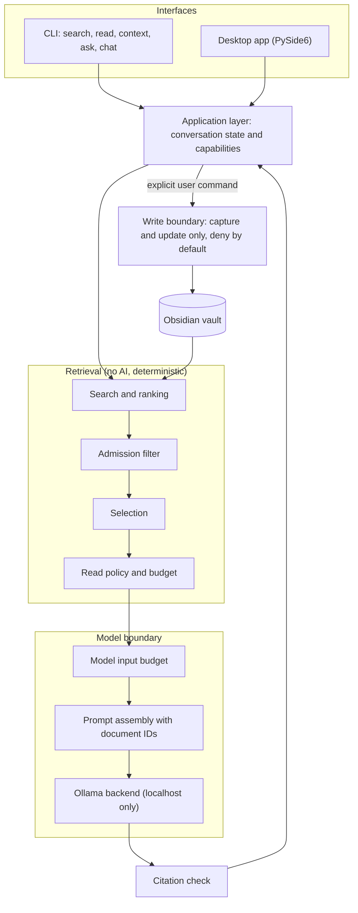

<h1 align="center">ARDANG</h1>

  <b>A local-first AI assistant that answers from your own notes.</b> 
  It searches an Obsidian vault, sends only the relevant notes to a model running on your PC, and shows where every answer came from.

  
  
  
  
  

<!-- DEMO: add assets/demo.gif and the 60-second video link here once recorded -->

> The source code is private while ARDANG is in active development.
> I'm happy to walk through it in a technical interview — [diegoisaiuwu@gmail.com](mailto:diegoisaiuwu@gmail.com).

---

## Why I built it

I keep years of notes in Obsidian, but finding the right one when I need it is slow, and cloud assistants would mean sending my notes to someone else's server. ARDANG answers from my notes with a model on my own machine, and it is built to stay under my control: it reads only what it needs, cites what it used, and never writes unless I tell it to.

## What it does today

| Capability | Command | What happens |
| --- | --- | --- |
| Search | `ardang search` | Ranks notes by relevance and returns paths and scores, never content. |
| Read | `ardang read` | Returns only the notes you name, within a byte and note budget. |
| Inspect context | `ardang context` | Shows exactly which notes a model would receive and why others were skipped. |
| Ask | `ardang ask` | Answers from the selected notes with a local Ollama model; `--sources` shows provenance. |
| Verify citations | `ardang ask --check-citations` | Flags answers that cite a note that was never sent to the model. |
| Chat | `ardang chat` | Multi-turn conversation on a fixed set of notes; `/new` opens a new topic. Nothing is saved. |
| Capture and update | `ardang capture` · `ardang update` | Creates a new note, or replaces one only if it still matches the version you expect. |
| Desktop app | `python -m ardang_desktop` | PySide6 window with the conversation, the context sent to the model and a "Remember" action. |

**Built so far:** 45 development phases, each closed with an audit. **Not built yet:** spoken voice answers, the phone app, automatic memory and semantic search (embeddings). I list these so the overview matches the code.

## How it works

The model only receives notes that passed search, admission, selection and both budgets. It has no tools and never sees the vault path.

## Design decisions

- **Searching is not permission to read.** Search returns paths only; reading is a separate step limited by a budget.
- **No silent failures.** If the most relevant note does not fit, ARDANG stops with a clear error instead of answering from weaker context. Requests to Ollama disable silent prompt truncation.
- **Local by default.** The Ollama client accepts only loopback addresses, and the core uses only the Python standard library.
- **The model gets text, not actions.** Writing a note always requires a command typed by the user.
- **Tested without the model.** The test suite runs with Ollama turned off because the HTTP transport is injectable.

<!-- SCREENSHOTS: desktop.png, ask-sources.png, context.png, tests.png in assets/ -->

## Tech stack

- **Core:** Python 3.10+, standard library only
- **Model:** Ollama on localhost (default model `qwen2.5:3b`), called over HTTP with `urllib`
- **Desktop:** PySide6
- **Knowledge base:** Obsidian vault (Markdown files)
- **Testing:** automated suite that runs without Ollama (injectable HTTP transport)
- **Platform:** Linux

## Roadmap

- [x] Local search, budgeted reading and context inspection
- [x] Local reasoning with Ollama, sources and citation checks
- [x] Ephemeral chat, controlled capture and update
- [x] Desktop app with voice capture boundary
- [ ] Phone client and voice answers

---

**Built by** [Diego Esparza](https://github.com/ARIOT117) · Chihuahua, Mexico · [LinkedIn](https://www.linkedin.com/in/diego-isai-esparza-barron-56a38a43b/)
