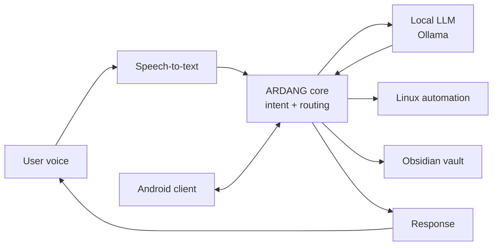

<h1 align="center">ARDANG</h1>

  <b>A local-first voice assistant for Linux and Android.</b> 
  Talk to your computer, run AI models on your own hardware, and keep your data at home.

  
  
  
  
  

> This repository is a project overview. The source code is private while ARDANG is in active development.
> I'm happy to walk through the code in a technical interview.

---

## Why I built it

Most voice assistants send what you say to a remote server and stop working without internet. I wanted one that runs on my own machines, understands my workflow on Linux, and connects to the notes I already keep in Obsidian.

## What it does

| Feature | Description |
| --- | --- |
| Voice interaction | Speak a command on the PC or phone and get an answer back. |
| Local AI | Language models run on my own hardware through Ollama — no cloud required for core features. |
| Desktop automation | Controls apps and system actions on Linux. |
| Obsidian integration | Works with the notes in my Obsidian vault. |
| PC ↔ phone | The same assistant is designed to work from my desktop and my Android phone. |
| Privacy-first | Voice and notes stay on my devices by default. |

## How it works

Simplified overview of the architecture.

## Tech stack

- **Language:** Python
- **AI:** Ollama (local models)
- **Platforms:** Linux desktop · Android
- **Integrations:** Obsidian

---

**Built by** [Diego](https://github.com/ARIOT117) · Chihuahua, Mexico
